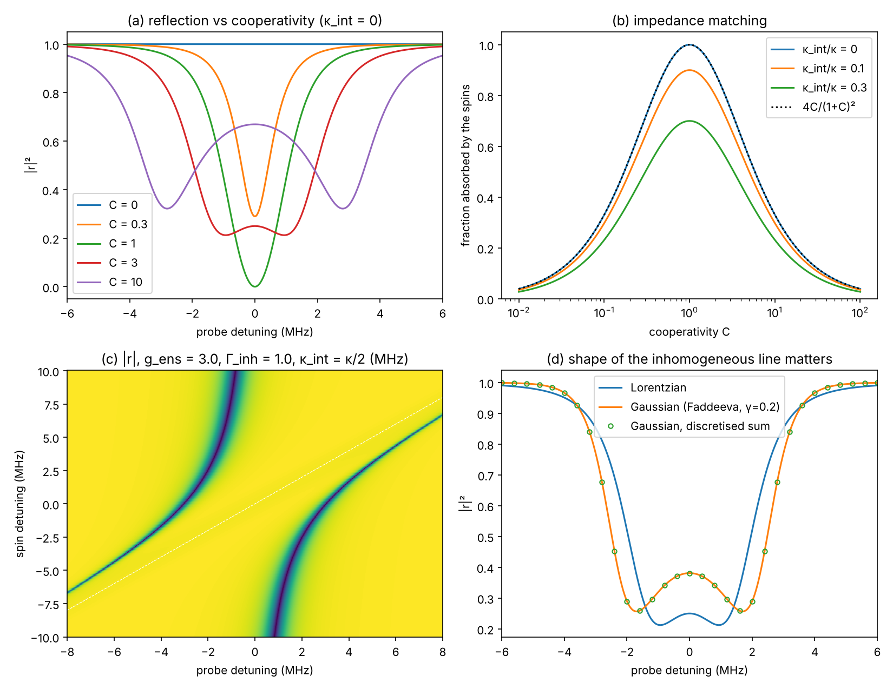
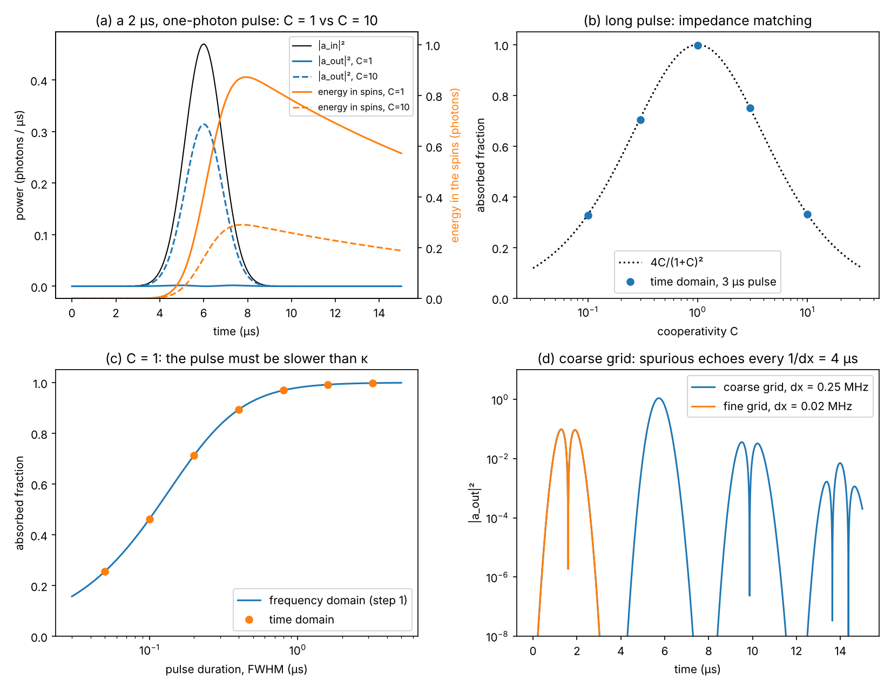
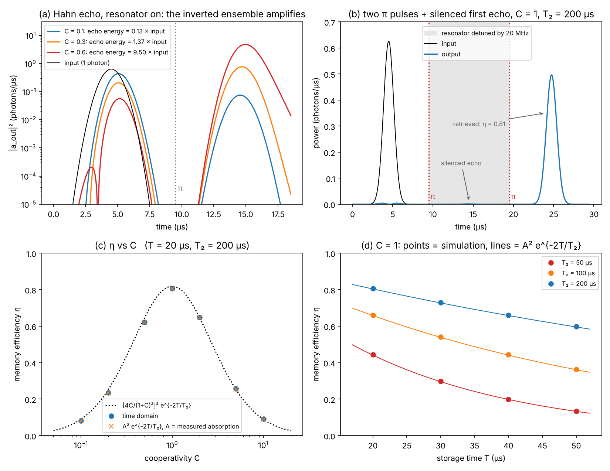
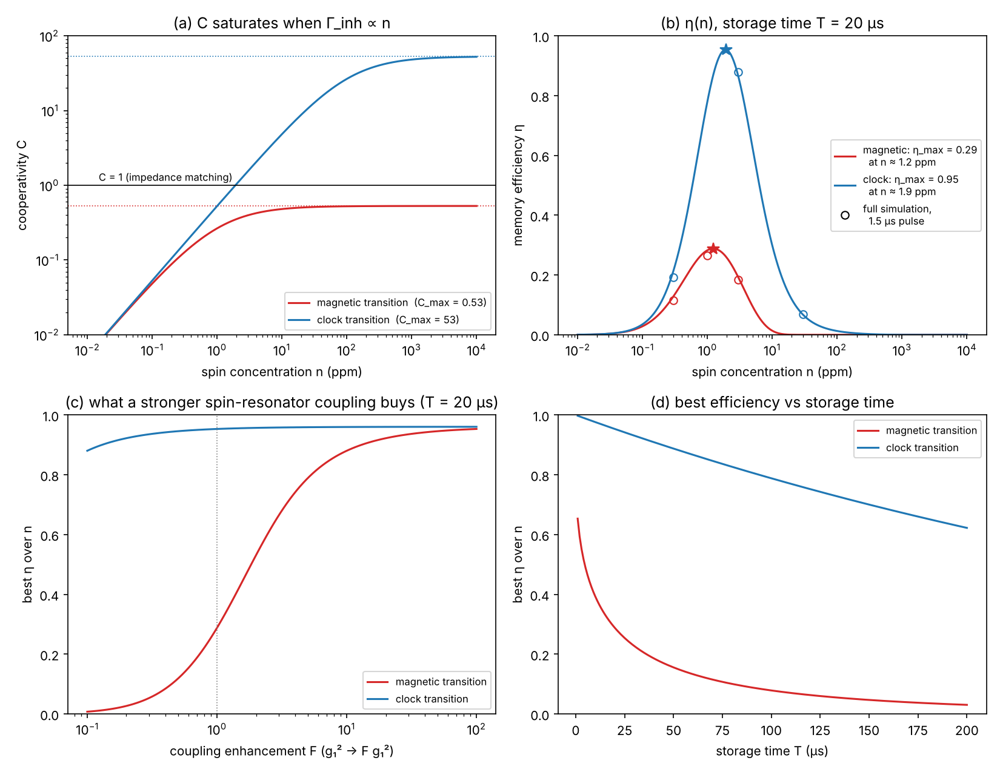

# Spin-Memory

**A toy model of a microwave quantum memory based on a spin ensemble coupled to a superconducting resonator.**

Self-study project. An inhomogeneously broadened spin ensemble is coupled to a
resonator probed in reflection and used to store microwave pulses with spin echoes.
The goal is to understand, with numbers, what limits the storage efficiency:
impedance matching, the inversion of the ensemble after a π pulse, and the
trade-off between spin concentration and coherence, and why clock transitions at
zero magnetic field (e.g. ¹⁷¹Yb³⁺:CaWO₄) help.

Everything is a linear, mean-field (classical amplitude) model written in Python
with NumPy/SciPy. The parameters are illustrative, not material data.

## Results

### 1. Steady-state spectrum `step01_spectrum.py`

Reflection from weak to strong coupling. At C = 1 the reflection vanishes: the
spins absorb everything (impedance matching), and the absorbed fraction is
4C/(1+C)². Internal resonator losses directly cap the efficiency (b). In strong
coupling the vacuum Rabi splitting is 2 g_ens (c); with a lossless resonator and a
Gaussian line the polaritons are barely damped ("cavity protection"). The shape of
the inhomogeneous line matters (d).

### 2. Pulse absorption in the time domain `step02_pulse.py`

The coupled equations are integrated with a discretised spin distribution. A slow
pulse is fully absorbed at C = 1 (a, b), and the absorption drops when the pulse is
shorter than ~1/κ (c). Time-domain and frequency-domain results agree to 10⁻⁴.
A discretised spin line rephases by itself after 1/dx and produces spurious echoes
(d) — the same mechanism as the atomic-frequency-comb memory protocol.

### 3. Echo memory `step03_echo.py`

After a π pulse the ensemble is inverted and the back-action of the spins changes
sign: κ/2 (1 + C) → κ/2 (1 − C). A plain Hahn echo with the resonator on resonance
is therefore *amplified* (a) — in a quantum treatment this gain comes with noise,
which rules it out for a quantum memory. The protocol used instead (b): two π
pulses, the resonator detuned during the first echo so that it is silenced, and the
second echo emitted with the spins back in the ground state. The simulated
efficiency follows η = [4C/(1+C)²]² exp(−2T/T₂) (c, d).

### 4. Concentration / coherence trade-off `step04_concentration.py`

Toy scalings with the spin concentration n: g_ens² ∝ n, Γ_inh = Γ₀ + a·n (dipolar
broadening), 1/T₂ = 1/T₂,₀ + b·n. Because C ∝ g_ens²/Γ_inh, the cooperativity
saturates at a value C_max that does not depend on n (a). If C_max < 1, no
concentration reaches impedance matching. A clock transition (a and b strongly
reduced) reaches C = 1 at a concentration where T₂ is still long (b). A stronger
single-spin coupling lets the optimum move to lower concentration, where T₂ is
longer (c). The scalings and the factor 100 between the two transitions are
illustrative choices: the qualitative message holds, the numbers say nothing about a
real material.

## Model

One resonator mode `a` (frequency ω_c, energy decay rate κ = κ_ext + κ_int), probed in
reflection, coupled to N spins. At low excitation each spin behaves as an oscillator
`b_j` (Holstein–Primakoff), with frequency ω_j drawn from a distribution ρ(Δ) of
FWHM Γ_inh, homogeneous linewidth γ (amplitude decay γ/2 = 1/T₂) and coupling g₀.
In the frame rotating at the probe frequency ω, with σ_z = −1 (ground state) or
+1 (inverted ensemble):

    da/dt   = -(i(ω_c - ω) + κ/2) a - i Σ_j g₀ b_j + √κ_ext a_in
    db_j/dt = -(i(ω_j - ω) + γ/2) b_j + i σ_z g₀ a
    a_out   = a_in - √κ_ext a

In the steady state (σ_z = −1):

    r(ω) = 1 - κ_ext / ( i(ω_c - ω) + κ/2 + W(ω) )
    W(ω) = g_ens² ∫ ρ(Δ) dΔ / ( i(ω_s + Δ - ω) + γ/2 ),   g_ens = g₀ √N

The cooperativity is defined from the on-resonance self-energy, C = 2 W(0)/κ
(C = 4 g_ens²/(κΓ) for a Lorentzian line), so that on resonance κ/2 → κ/2 (1 + C)
whatever the line shape. For a Gaussian line, W is computed with the Faddeeva
function. An ideal π pulse is modelled as b_j → b_j* and σ_z → −σ_z.

**Units.** Parameters are given as ordinary frequencies in MHz (i.e. divided by 2π)
and times in µs. In the steady state the 2π factors cancel; in the time domain the
rates are converted to angular frequencies inside the code.

## Usage

    pip install -r requirements.txt
    python step01_spectrum.py          # ~2 s
    python step02_pulse.py             # ~15 s
    python step03_echo.py              # ~20 s
    python step04_concentration.py     # ~15 s

Each script prints its sanity checks (energy balance, comparison with the analytic
formulas) and writes its figure to `figures/`. The shared functions are in
`spinmem.py`.

## Limits

- Linear, mean-field model: no spontaneous emission, so the noise added by an
  inverted ensemble is not computed, only its gain.
- Ideal, instantaneous π pulses; no spin–spin interactions beyond the toy scalings
  of step 4; no spin polarisation or temperature effects.
- Single-mode resonator, single-port reflection geometry.

## References

- M. Afzelius, N. Sangouard, G. Johansson, M. U. Staudt, C. M. Wilson,
  *Proposal for a coherent quantum memory for propagating microwave photons*,
  New J. Phys. **15**, 065008 (2013).
- C. Grezes et al., *Storage and retrieval of microwave fields at the single-photon
  level in a spin ensemble*, Phys. Rev. A **92**, 020301(R) (2015).
- A. Tiranov et al., *Sub-second spin and lifetime-limited optical coherences in
  ¹⁷¹Yb³⁺:CaWO₄*, arXiv:2504.01592.
